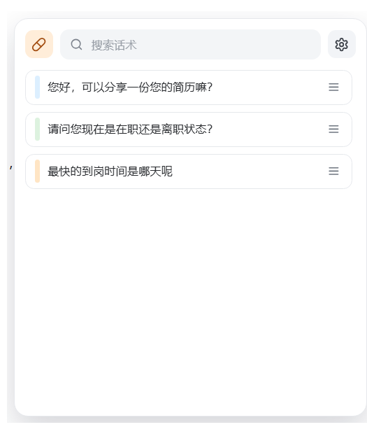

# 聊天胶囊 ChatCapsule

> 像输入法一样好用的聊天话术助手 —— 让高频沟通内容始终近在手边。

[](https://www.electronjs.org/)
[](https://react.dev/)
[](https://www.typescriptlang.org/)
[](https://github.com/Longjinxin/chat-capsule)
[](LICENSE)

**聊天胶囊**是一款 Windows 桌面端聊天话术效率工具，为招聘、HR、销售、客服、BD 等需要高频发送预设话术的人群打造。核心场景：在不离开当前聊天软件、不打断工作流的前提下，通过全局快捷键快速保存、搜索并插入常用话术。

<p align="center">
  
</p>

## ✨ 核心特性

- **🔗 全局唤起** — `Ctrl+Alt+Space` 随时呼出悬浮胶囊，常驻屏幕右上角，不遮挡工作区
- **⚡ 两步插入** — 搜索 → 单击，话术即进入当前聊天输入框（Clipboard + Ctrl+V 实现，插入前自动保存并恢复剪贴板）
- **📝 极速收藏** — 任意应用中选中文字，按快捷键即保存为新胶囊，无需切换窗口
- **🔍 全文搜索** — 输入正文任意关键词实时过滤，悬停查看完整内容
- **🔁 一键替换** — 选中新版本文字按替换快捷键，即可用新内容更新旧胶囊
- **🎨 轻量管理** — 颜色标记、拖拽排序、编辑删除、导入导出 JSON
- **⌨️ 快捷键完全自定义** — 所有全局快捷键均可在设置中修改，冲突自动检测

## 🔒 三大产品原则

| 原则 | 说明 |
| --- | --- |
| **不打断工作流** | 悬浮胶囊常驻后台，唤起、搜索、插入全程不离开聊天窗口 |
| **绝不自动发送** | 话术只进入输入框，发送永远由你按下回车，内容发出前可自由修改 |
| **本地优先** | 零账号、零云端、零聊天内容采集，所有数据仅存于本机 SQLite |

## 🚀 快速开始

### 普通用户

双击 `start.bat`（或 `quickstart.bat`），脚本会自动完成原生依赖切换、构建并启动应用。

### 开发者

```bash
# 环境要求：Node.js 18+，Windows 10/11
git clone https://github.com/Longjinxin/chat-capsule.git
cd chat-capsule
npm install          # 自动将 better-sqlite3 重编译到 Electron ABI
npm run dev          # 构建并启动
```

### 打包发布

```bash
npm run build
npx electron-builder   # 产物输出至 release/
```

## ⌨️ 默认快捷键

| 功能 | 默认快捷键 |
| --- | --- |
| 唤起 / 收起面板 | `Ctrl+Alt+Space` |
| 保存选中文本为新胶囊 | `Ctrl+Shift+C` |
| 替换旧胶囊 | `Ctrl+Shift+R` |

> 所有快捷键均可在应用设置中自定义，与系统冲突时会明确提示。

## 🏗️ 技术架构

```
Electron 37 + React 19 + TypeScript 5 + Vite 7
├── 主进程   窗口管理 / 全局快捷键 / 剪贴板插入 / 前台窗口跟踪（Win32）
├── 预加载   contextIsolation 安全桥接
└── 渲染层   React UI：搜索 / 胶囊卡片 / 拖拽排序 / 设置面板
数据层：better-sqlite3 本地存储（AppData 下，零云端依赖）
```

**几个值得一提的技术点：**

- **跨应用插入**：通过持续跟踪 Windows 前台窗口定位插入目标，不针对微信 / Slack / Boss 直聘写死逻辑，任意输入框通用
- **剪贴板零损耗**：插入前保存用户剪贴板内容，插入后自动恢复
- **GPU 兼容性**：内置软件渲染回退（SwiftShader），远程桌面 / 虚拟机 / 无显卡环境稳定运行

## 📁 目录结构

```
src/
├── main/       # 主进程：窗口、快捷键、插入引擎、Win32 集成
├── preload/    # IPC 安全桥
├── renderer/   # React 界面
├── db/         # SQLite 仓储层
└── shared/     # 主/渲染共享类型与常量
tests/          # Vitest 单元测试
docs/           # 产品文档（PRD / 技术设计 / UI-UX）
```

## 🗺️ Roadmap

- [ ] 悬浮窗位置记忆
- [ ] 多显示器支持优化
- [ ] 安装包自动更新

## 📄 License

[MIT](LICENSE) © Longjinxin
