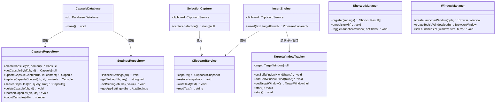
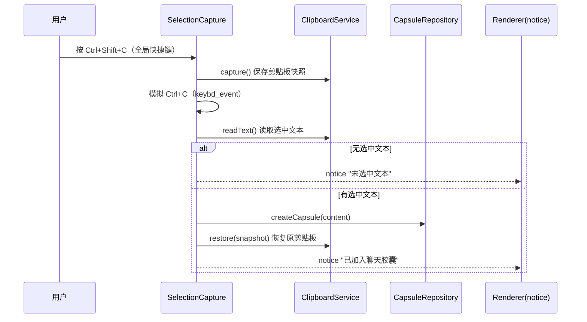
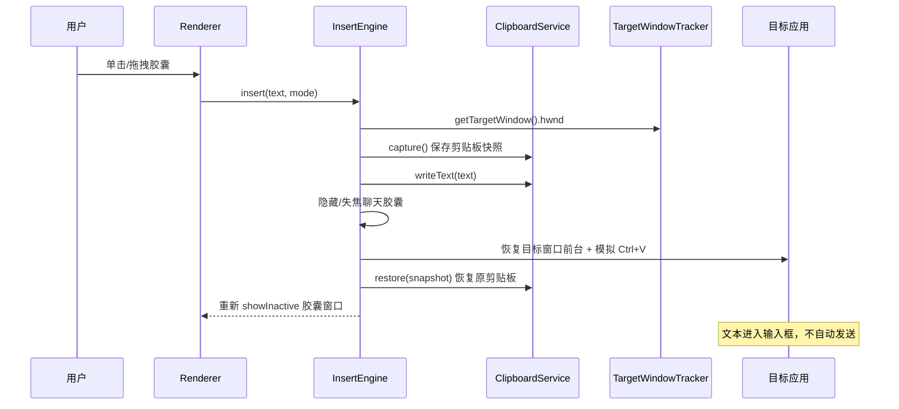
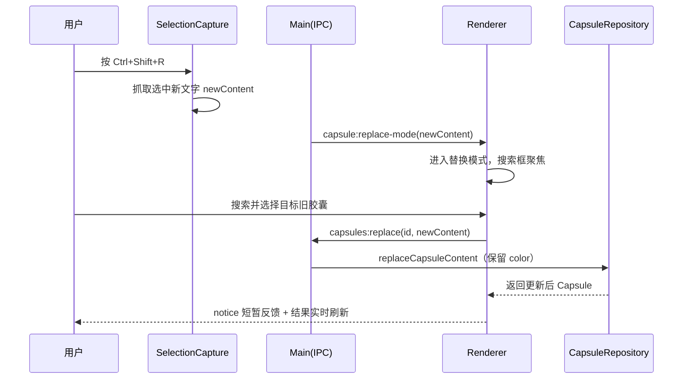
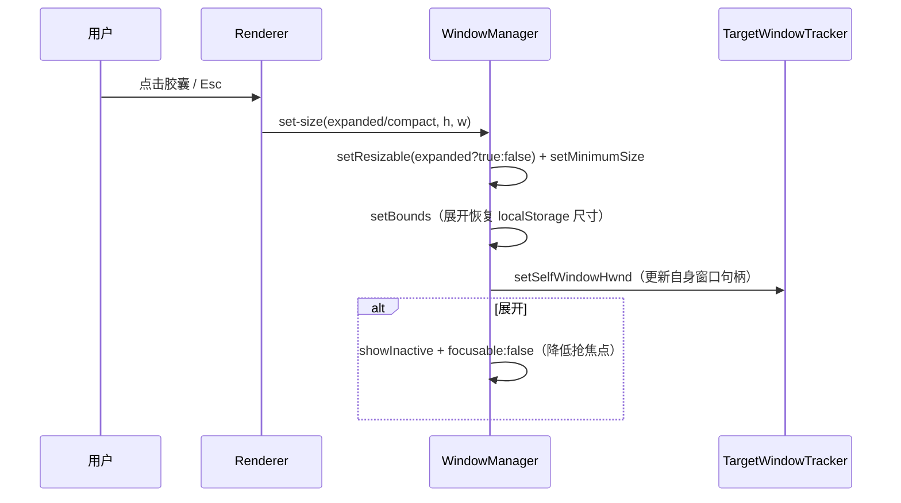

# 聊天胶囊 · 系统架构设计与任务分解（技术设计终版）

> **版本**：Final v1.0
> **基线**：以 `PRD-final.md`（权威需求基线）为唯一需求依据，配合技术决策清单（技术栈、数据库引擎、跨应用文本操作、窗口管理、安全）。
> **读者**：工程师（寇豆码）——本文档是代码实现的唯一依据。
> **语言**：简体中文。

---

## 0. 文档约定

| 标记 | 含义 |
| --- | --- |
| **P0** | 必做，硬性范围 |
| **P1** | 应做 |
| **P2** | 本次可不实现 |
| `main` | Electron 主进程（Node.js 环境，CommonJS） |
| `preload` | 预加载脚本（contextBridge 桥接层） |
| `renderer` | 渲染进程（React + Vite，ESM） |
| `db` | 数据访问层（主进程内运行） |
| `shared` | main/preload/renderer 共享的纯类型与常量（无运行时副作用） |

---

## 1. 实现方案与框架选型

### 1.1 核心挑战分析

| # | 技术难点 | 风险等级 | 应对策略 |
| --- | --- | --- | --- |
| 1 | 跨应用选中文本抓取 | 高 | 全局快捷键 → 保存剪贴板 → 模拟 Ctrl+C → 读剪贴板 → 恢复剪贴板 |
| 2 | 跨应用文本注入（不写死应用） | 高 | 统一 `InsertEngine`：Clipboard + Ctrl+V；`TargetWindowTracker` 跟踪真实前台窗口 |
| 3 | 不抢焦点 / 不打断工作流 | 高 | 收起态 `focusable:false` + `showInactive()`；展开切换动态控制 `resizable` |
| 4 | better-sqlite3 原生模块与 Electron ABI 匹配 | 高（安装阶段） | 用 `@electron/rebuild` 重建；electron-builder `install-app-deps`（详见 1.3） |
| 5 | 全局快捷键冲突 | 中 | 注册失败检测 + 冲突提示 + 可自定义 |
| 6 | 面板尺寸记忆与窗口异常 | 中 | 尺寸用 `localStorage`；位置暂强制右上角（P2 再设计位置恢复） |

### 1.2 技术栈选型

| 层次 | 选型 | 理由 |
| --- | --- | --- |
| 桌面壳 | Electron `^37.2.0` | Windows 悬浮窗 / 全局快捷键 / 剪贴板 / 原生句柄能力成熟 |
| 语言 | TypeScript `^5.8.3` | 类型约束便于 AI 协作与长期维护 |
| UI | React `^19.1.0` + Vite `^7.0.0` | 快速开发，HMR 高效；`@vitejs/plugin-react` |
| 数据引擎 | **better-sqlite3** | 见 1.3 决策理由 |
| 打包 | electron-builder | Windows x64 `.exe`（P2 范围，但依赖与配置本次就绪） |
| 测试 | Vitest `^3.2.4` | 与 Vite 同生态，node 环境跑 repository / 引擎纯逻辑测试 |

### 1.3 better-sqlite3 决策理由 + 原生模块构建方案

**为何弃用 sql.js（WASM 全量导出）**：

| 维度 | sql.js（旧） | better-sqlite3（新） |
| --- | --- | --- |
| 持久化 | 内存态 + `db.export()` 全量写盘 | 原生绑定，事务性增量写盘，崩溃恢复可靠 |
| 写可靠性 | 需手动 `persist()`，漏调会丢数据 | `WAL` 模式 + 每语句自动落盘 |
| 并发 / 崩溃 | 全量导出耗时长，进程异常易丢 | SQLite 原生 journaling |
| 性能 | 数据量大后全量导出变慢 | 恒定快，符合"稳定优先" |

**决策**：采用 `better-sqlite3`，符合"稳定优先"产品原则。

**原生模块构建方案（关键执行步骤）**：

```
# 1) 移除 pnpm 残留，改用 npm（环境无 pnpm）
rm -f pnpm-lock.yaml pnpm-workspace.yaml

# 2) 安装依赖
npm install

# 3) 重建 better-sqlite3 以匹配 Electron ABI（三种方式任选其一）
#    方式 A（推荐，开发期）：@electron/rebuild
npx @electron/rebuild -f -w better-sqlite3

#    方式 B（打包期，electron-builder 自动调用）：
#    electron-builder 会在 build 前执行 install-app-deps，自动 rebuild 原生依赖
```

> **必须注意**：`better-sqlite3` 的编译需要本机具备 C++ 编译工具链。若机器缺 prebuilt 匹配二进制，Windows 下需安装 Visual Studio Build Tools（含 C++ 桌面工作负载）与 Python。`@electron/rebuild` 优先下载 prebuilt，失败才本地编译。此为本项目**安装阶段头号风险**，需在 `README` 中给出可执行步骤。

### 1.4 架构模式

- **分层架构**：`renderer（UI）→ preload（桥接，仅暴露白名单 API）→ ipcMain（参数校验）→ service/repository（业务+数据）→ better-sqlite3`。
- **单一数据入口**：所有数据库访问收敛在 `db/` 的 repository，UI 不得直接触碰 SQLite 文件。
- **引擎化跨应用操作**：`InsertEngine`（注入）、`TargetWindowTracker`（前台窗口）、`ClipboardService`（快照/恢复）各自独立可测。

---

## 2. 目录结构（完整文件清单）

```
聊天胶囊/
├── package.json
├── tsconfig.json
├── tsconfig.main.json
├── tsconfig.renderer.json
├── vite.config.ts
├── vitest.config.ts
├── electron-builder.yml              # P2 打包配置（本次就绪）
├── .gitignore
├── scripts/
│   └── rebuild-native.cjs            # 封装 @electron/rebuild 的 npm 脚本
├── src/
│   ├── shared/                       # 跨进程共享（纯类型 + 常量，无副作用）
│   │   ├── types.ts
│   │   ├── constants.ts
│   │   └── ipc.ts                    # IPC channel 常量 + 请求/响应类型（新增）
│   ├── db/                           # 数据访问层（主进程）
│   │   ├── database.ts               # better-sqlite3 连接 + schema + 迁移
│   │   ├── capsuleRepository.ts
│   │   └── settingsRepository.ts
│   ├── main/                         # 主进程
│   │   ├── main.ts                   # 入口 + IPC 注册 + 生命周期编排
│   │   ├── window.ts                 # 收起/展开窗口 + Tooltip + 尺寸记忆
│   │   ├── shortcuts.ts              # 全局快捷键注册/冲突检测
│   │   ├── clipboard.ts              # ClipboardService：快照/写入/恢复（新增）
│   │   ├── selectionCapture.ts       # 选中文本抓取（Ctrl+C 流程，新增）
│   │   ├── insertion.ts              # InsertEngine：Clipboard + Ctrl+V
│   │   └── targetWindowTracker.ts    # 前台窗口跟踪
│   ├── preload/
│   │   └── preload.ts                # contextBridge 暴露 window.capsuleApi
│   └── renderer/
│       ├── index.html
│       ├── main.tsx
│       ├── env.d.ts
│       ├── App.tsx
│       ├── components/
│       │   ├── CapsuleCard.tsx
│       │   ├── CapsuleList.tsx
│       │   ├── CapsuleTooltip.tsx     # hover 完整内容浮层
│       │   ├── SearchBox.tsx
│       │   ├── HighlightText.tsx      # 关键词高亮（新增）
│       │   ├── AddInput.tsx           # "+" 新增输入态（新增）
│       │   ├── SettingsPanel.tsx      # 快捷键/置顶设置（新增）
│       │   └── ResizeHandle.tsx       # 右下角缩放把手（Pointer Capture）
│       ├── hooks/
│       │   └── useCapsules.ts         # 搜索/增删改/排序状态封装（新增）
│       └── styles/
│           └── app.css
├── tests/
│   ├── capsuleRepository.test.ts
│   ├── settingsRepository.test.ts
│   ├── insertion.test.ts
│   ├── selectionCapture.test.ts       # 新增
│   ├── shortcuts.test.ts
│   └── targetWindowTracker.test.ts
└── docs/
    ├── PRD-final.md
    └── TECHNICAL_DESIGN-final.md
```

> 现有 `src/main/insertion.ts`、`targetWindowTracker.ts`、`window.ts`、`shortcuts.ts`、`db/*`、`shared/*` 均保留并改造；`sql.js` 相关代码由 `database.ts` 整体替换为 better-sqlite3。`src/main/clipboard.ts`、`selectionCapture.ts`、若干 renderer 组件与 `hooks/useCapsules.ts` 为新增。

---

## 3. 数据模型（SQL Schema）

### 3.1 capsules

```sql
CREATE TABLE IF NOT EXISTS capsules (
  id          INTEGER PRIMARY KEY AUTOINCREMENT,
  content     TEXT    NOT NULL,
  color       TEXT    NOT NULL,
  sort_order  INTEGER NOT NULL DEFAULT 0,
  created_at  INTEGER NOT NULL,
  updated_at  INTEGER NOT NULL
);
CREATE INDEX IF NOT EXISTS idx_capsules_sort ON capsules (sort_order ASC, id ASC);
```

### 3.2 settings

```sql
CREATE TABLE IF NOT EXISTS settings (
  key   TEXT PRIMARY KEY,
  value TEXT NOT NULL
);
```

### 3.3 迁移策略（better-sqlite3 版）

- 用 `PRAGMA user_version` 做版本号，启动时按版本顺序执行迁移。
- 迁移 v1→v2：若 `capsules` 无 `sort_order` 列，则 `ALTER TABLE capsules ADD COLUMN sort_order INTEGER NOT NULL DEFAULT 0;` 随后 `UPDATE capsules SET sort_order = id WHERE sort_order = 0;`（沿用旧库自动迁移补全逻辑，等价语义）。
- 连接使用 `PRAGMA journal_mode = WAL;` 与 `PRAGMA foreign_keys = ON;`。
- `sort_order` 语义：新胶囊 `sort_order = MAX(sort_order)+1`；排序按 `ORDER BY sort_order ASC, id ASC`。

---

## 4. 数据结构与接口（TypeScript）

### 4.1 核心类型

```ts
// src/shared/types.ts
export interface Capsule {
  id: number;
  content: string;
  color: string;
  sort_order: number;
  created_at: number;
  updated_at: number;
}

export type LauncherSize = 'compact' | 'expanded';

export interface AppSettings {
  globalHotkeyOpen: string;
  globalHotkeyAdd: string;
  globalHotkeyReplace: string;
  alwaysOnTop: boolean;
  launchOnStartup: boolean;
  windowPosition: { x: number; y: number } | null;
}

export interface TargetWindow {
  hwnd: number;
  processId: number;
  processName: string;
  title: string;
  timestamp: number;
}

export interface InsertPayload {
  text: string;
  mode: 'drag' | 'click';
}

export interface ReplacePayload {
  capsuleId: number;
  newContent: string;
}

// 面板尺寸记忆（localStorage）
export interface PanelSize {
  width: number;
  height: number;
}
```

### 4.2 类图



---

## 5. IPC 通道清单

> 约定：`invoke`（有返回值）与 `send`（无返回值单向）区分。所有 `handle` 入参在 handler 内做运行时校验（类型 + 范围），非法即抛错或直接忽略。

| Channel | 方向 | 入参 | 出参 | 校验规则 | 对应 PRD |
| --- | --- | --- | --- | --- | --- |
| `capsules:search` | invoke | `query: string`, `limit?: number` | `Capsule[]` | `query` 为 string；`limit` 可选，1~200 整数 | P0-3 |
| `capsules:add` | invoke | `content: string` | `Capsule` | `content` 非空 string，长度 ≤ 20000 | P0-1/P0-2 |
| `capsules:update` | invoke | `id: number`, `content: string` | `Capsule` | `id` 整数，`content` 非空 string | P1-1 |
| `capsules:replace` | invoke | `id: number`, `content: string` | `Capsule` | 同上；保留 `color` | P0-5 |
| `capsules:remove` | invoke | `id: number` | `void` | `id` 整数 | P1-2 |
| `capsules:reorder` | invoke | `ids: number[]` | `void` | 数组且每项整数 | P1-3 |
| `settings:get` | invoke | `—` | `AppSettings` | — | P1-4 |
| `settings:setHotkey` | invoke | `{ key, accelerator }` | `{ registered, conflict }` | `key` ∈ 三个热键 key；`accelerator` string | P1-4 |
| `capsule:insert` | send | `InsertPayload` | — | `text` string，`mode` ∈ drag/click | P0-4 |
| `capsule:set-size` | send | `size`, `height?`, `width?` | — | `size` ∈ compact/expanded；数字有限 | P1-5 |
| `capsule:resize` | send | `width`, `height` | — | 有限数字，clamp ≥280/240 | P1-5 |
| `capsule:move` | send | `x`, `y` | — | 有限数字 | P2（占位） |
| `capsule:activate` / `deactivate` | send | `—` | — | — | 窗口管理 |
| `capsule:tooltip-show` / `-hide` | send | `—` | — | — | 收起态 Tooltip |
| `capsule:context-menu` | send | `—` | — | — | 右键菜单 |
| `capsule:hide` | send | `—` | — | — | 收起 |
| `capsule:replace-mode` | 主→渲染 | `newContent: string` | — | 进入替换模式（快捷键触发） | P0-5 |
| `capsule:global-open` | 主→渲染 | `—` | — | 唤起聚焦 | P0-3 |
| `capsule:notice` | 主→渲染 | `message: string` | — | 轻量提示（约 1 秒） | P0-2/P0-5 |

**preload 暴露白名单**（`window.capsuleApi`，与现有 `CapsuleApi` 接口扩展对齐）：

```ts
search / add / update / replace / remove / reorder
getSettings / setHotkey
setSize / resize / moveWindow
insertText(text, mode)
activate / deactivate / showTooltip / hideTooltip / showContextMenu / hide
onGlobalOpen(cb) / onNotice(cb) / onReplaceMode(cb)
```

---

## 6. 程序调用流程（关键时序图）

### 6.1 保存选中文本（P0-2）



### 6.2 插入话术（P0-4）



### 6.3 替换话术（P0-5）



### 6.4 窗口收起/展开切换（P1-5 + 窗口管理）



---

## 7. 任务列表（按实现顺序）

> 硬性约束：不超过 5 个任务；首任务为「项目基础设施 + 数据层」；按依赖排序；每项标注 PRD 功能编号。

| Task ID | 任务名 | 来源文件 | 依赖 | 优先级 | PRD 覆盖 |
| --- | --- | --- | --- | --- | --- |
| **T01** | 项目基础设施 + 数据层（better-sqlite3 迁移） | `package.json`、`scripts/rebuild-native.cjs`、`.gitignore`、`tsconfig*.json`、`vite.config.ts`、`vitest.config.ts`、`src/db/database.ts`、`src/db/capsuleRepository.ts`、`src/db/settingsRepository.ts`、`src/shared/types.ts`、`src/shared/constants.ts`、`src/shared/ipc.ts`、`tests/capsuleRepository.test.ts`、`tests/settingsRepository.test.ts` | — | P0 | P0-1~P0-5（数据基座） |
| **T02** | 窗口 + 快捷键 + 目标窗口跟踪（主进程基础设施） | `src/main/window.ts`、`src/main/shortcuts.ts`、`src/main/targetWindowTracker.ts`、`src/main/main.ts`、`tests/shortcuts.test.ts`、`tests/targetWindowTracker.test.ts` | T01 | P0 | P0-2/P0-3 唤起、P1-4、窗口管理 |
| **T03** | 跨应用文本引擎（抓取 + 插入 + 替换） | `src/main/clipboard.ts`、`src/main/selectionCapture.ts`、`src/main/insertion.ts`、`tests/insertion.test.ts`、`tests/selectionCapture.test.ts` | T02 | P0 | P0-2、P0-4、P0-5 |
| **T04** | 渲染层核心 UI（搜索 + 列表 + 新增 + 卡片交互） | `src/renderer/App.tsx`、`src/renderer/components/{SearchBox,HighlightText,CapsuleList,CapsuleCard,CapsuleTooltip,AddInput}.tsx`、`src/renderer/hooks/useCapsules.ts`、`src/renderer/styles/app.css` | T01、T03 | P0 | P0-1、P0-3、P1-1、P1-2、P1-3 |
| **T05** | 设置面板 + 尺寸记忆 + 集成收尾 | `src/preload/preload.ts`、`src/renderer/components/{SettingsPanel,ResizeHandle}.tsx`、`src/renderer/env.d.ts`、`src/main/main.ts`（IPC 补全）、`electron-builder.yml` | T02、T04 | P1 | P1-4、P1-5 |

**说明**：T02 与 T03 存在顺序依赖（T03 的 InsertEngine 需要 T02 的窗口隐藏/恢复与目标窗口），T04 依赖 T03（插入/替换 IPC 就绪）。T01 为全量基座。

---

## 8. 依赖包清单

### 8.1 dependencies

| 包 | 版本 | 用途 |
| --- | --- | --- |
| `react` | `^19.1.0` | UI 框架 |
| `react-dom` | `^19.1.0` | React DOM |
| `better-sqlite3` | `^11.8.0`（或与 Electron 37 ABI 匹配的最新版） | 原生 SQLite |
| `lucide-react` | `^0.525.0` | 图标（保留现有） |

> **移除**：`sql.js` 与 `@types/sql.js`（被 better-sqlite3 取代）。

### 8.2 devDependencies

| 包 | 版本 | 用途 |
| --- | --- | --- |
| `electron` | `^37.2.0` | 桌面壳 |
| `electron-builder` | `^25.1.8` | Windows 打包（P2 就绪） |
| `@electron/rebuild` | `^3.7.1` | 重建 better-sqlite3 匹配 Electron ABI |
| `typescript` | `^5.8.3` | 类型 |
| `vite` | `^7.0.0` | 构建 |
| `@vitejs/plugin-react` | `^5.0.0` | React HMR |
| `vitest` | `^3.2.4` | 测试 |
| `@types/node` | `^24.0.0` | Node 类型 |
| `@types/react` | `^19.1.0` | React 类型 |
| `@types/react-dom` | `^19.1.0` | React DOM 类型 |
| `@types/better-sqlite3` | `^7.6.11` | better-sqlite3 类型 |

---

## 9. 共享知识（跨文件约定）

### 9.1 命名规范

- 文件：`kebab-case.ts`（如 `capsule-repository` 内部函数用小驼峰）；React 组件 `PascalCase.tsx`。
- 常量：`UPPER_SNAKE_CASE`；类型/接口 `PascalCase`；变量/函数 `camelCase`。
- 数据库字段：`snake_case`（`sort_order`、`created_at`）；TS 对象字段沿用 `snake_case` 以与 DB 对齐（现有约定，保持一致）。

### 9.2 常量集中位置

- 所有魔法数字/文案集中 `src/shared/constants.ts`：`WINDOW_SIZES`、`WINDOW_MARGIN`、`DEFAULT_SEARCH_LIMIT=200`、`MAX_CAPSULE_LENGTH=20000`、`MAX_QUERY_LENGTH=200`、`CAPSULE_COLORS`、`DEFAULT_SETTINGS`。
- 新增常量：面板最小尺寸 `280×240`、收起态 `64×32`、Tooltip 延迟 `300ms`、提示时长 `~1000ms`。

### 9.3 错误处理约定

- repository 抛 `Error`（中文可读信息，如"话术内容不能为空"）；IPC handler 捕获后返回统一结果或抛出，由 renderer 展示轻量提示。
- `InsertEngine.insert` 返回 `Promise<boolean>`，失败不抛异常，交由调用方 `notice` 提示"插入失败"。
- 剪贴板恢复放在 `finally` 中保证执行。

### 9.4 SQL 与安全

- **SQL 一律参数化**（better-sqlite3 `prepare` + `bind`），禁止字符串拼接用户输入。
- LIKE 查询用 `ESCAPE '!'`，`escapeLike` 转义 `!%_`。
- 搜索 `ORDER BY sort_order ASC, id ASC`，`limit` 上限 200。
- 所有 DB 写操作集中在 repository，禁止 renderer 直接操作文件。

### 9.5 进程边界

- renderer 不引入 `node:` 模块；`contextIsolation: true`、`nodeIntegration: false`。
- preload 仅 `contextBridge.exposeInMainWorld('capsuleApi', ...)` 暴露白名单。
- main 与 renderer 通信只经 IPC channel（第 5 节清单）。

### 9.6 其他

- 时间戳统一 `Date.now()`（毫秒，UTC 语义）。
- 面板尺寸用 `localStorage.capsule_panel_size`；收起位置暂强制右上角（`localStorage.capsule_position` 暂不启用恢复）。
- 颜色轮换 `CAPSULE_COLORS[count % length]`。

---

## 10. 待明确事项 / 风险清单

| # | 风险 / 待明确 | 等级 | 说明与缓解 |
| --- | --- | --- | --- |
| 1 | **better-sqlite3 原生编译** | 🔴 高 | Electron ABI 不匹配会启动即崩。缓解：`@electron/rebuild` 重建；打包走 `install-app-deps`；README 给出 VS Build Tools + Python 步骤；优先 prebuilt。 |
| 2 | **跨应用 Ctrl+C 兼容性** | 🟠 中 | 部分应用（如某些 Electron 应用/远程桌面）对合成 Ctrl+C 响应异常。缓解：保留"界面 +"手动新增兜底；无选中文本时明确提示。 |
| 3 | **跨应用 Ctrl+V 兼容性** | 🟠 中 | 不同输入框 UI 技术（原生/WEB/富文本）对合成粘贴敏感度不同。缓解：统一 InsertEngine + 恢复前台窗口 + 80ms 延迟；微信/Slack/Boss 以人工实测为准。 |
| 4 | **剪贴板恢复竞态** | 🟡 中 | 注入后立即恢复可能与目标应用粘贴存在时序竞争。缓解：`finally` 恢复 + `delay(300ms)`；必要时可短暂延迟恢复。 |
| 5 | **全局快捷键冲突** | 🟡 中 | 系统/其他软件抢占。缓解：注册失败检测 + 冲突提示 + 可自定义。 |
| 6 | **窗口位置记忆异常** | 🟡 中 | 已知启动窗口异常。缓解：本次强制默认右上角，位置恢复策略列为 P2 重新设计。 |
| 7 | **npm 重建依赖** | 🟢 低 | 无 pnpm，需 `npm install` + 删除 pnpm 锁文件；`better-sqlite3` 需 rebuild。 |
| 8 | **多显示器/DPI** | 🟢 低 | 本次默认主显示器右上角；多显示器/位置记忆 P2。 |

---

## 附：与旧实现（sql.js）的差异要点（工程师迁移注意）

1. `src/db/database.ts`：`openCapsuleDatabase` 改为同步 `better-sqlite3` 连接；删除 `persist()` 全量导出逻辑；改为 WAL + `user_version` 迁移；`CapsuleDatabase.db` 类型由 `SqlJs.Database` 改为 `better-sqlite3` 的 `Database.Database`。
2. repository 中 `db.exec(...)` / `db.run(...)` / `stmt.getAsObject()` 等 sql.js API 需整体改写为 better-sqlite3 的 `db.prepare(...).get/all/run` 语法（`reorderCapsules` 建议用事务 `db.transaction`）。
3. `main.ts` 中每次写操作后的 `database.persist()` 调用可移除（better-sqlite3 自动落盘）。
4. 新增 `ClipboardService`（从 `insertion.ts` 内联的 snapshot 逻辑抽取复用），供抓取与插入共享。
5. `SelectionCapture` 新增，承载 P0-2/P0-5 的选中文本抓取（Ctrl+C 流程）。
6. IPC 通道新增 `capsules:replace`、`settings:*`、`capsule:replace-mode`，preload 对应扩展。
